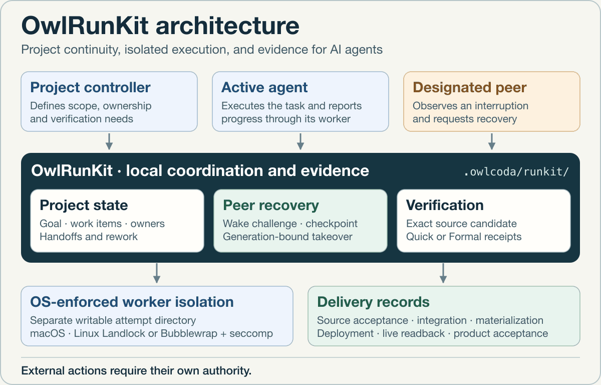
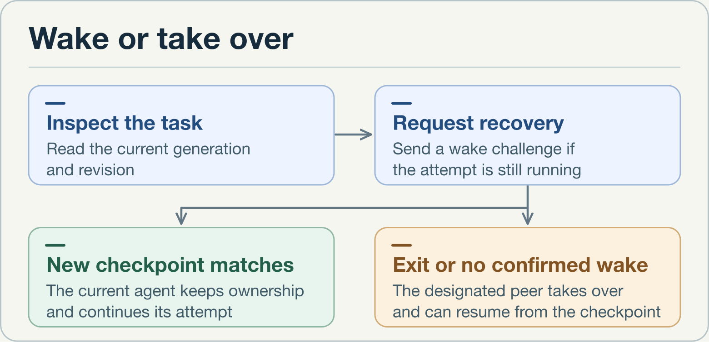

# OwlRunKit

**English** · [中文](README.zh.md) · [Usage guide](docs/guide.md) · [Releases](https://github.com/yeemio/owlrunkit/releases)

[](https://www.npmjs.com/package/owlrunkit)
[](LICENSE)

**Questions, feedback, or ideas?** Find me on X at [@yeemio](https://x.com/yeemio).

OwlRunKit is a local-first project driver for AI agents. It keeps goals, owners,
source candidates, checkpoints, and verification receipts in the project so
another agent can pick up the work with its context and evidence intact.

## Architecture


<details>
<summary>Play the architecture walkthrough</summary>



</details>

The agent host provides the trigger for the cooperating agent. Agents choose
the next action and supply worker commands. RunKit records
ownership, checks the expected state before changes, and binds the outcome
to its evidence. The operating system enforces the worker's isolation.
Git, publication, and deployment each require their own authority.

## Wake or take over



1. **Define the task before execution.** Name the current agent, the designated
   successor, and the exact files that may be checkpointed.
2. **Look for actual progress.** The designated peer reads the task's generation
   and revision with `peer inspect`, then requests recovery. RunKit challenges
   a running worker with a wake ID. The worker proves progress by submitting a
   changed checkpoint with that ID. An ACK alone leaves the wake unconfirmed.
3. **Claim the next generation.** If the worker has exited or the bounded wake
   attempt ends without confirmed progress, RunKit can record the designated peer
   as the owner at a new generation. A single durable revision binds the handoff to
   the last accepted checkpoint. Stale claims and late checkpoint reports are
   rejected. The peer may supply its worker command to `peer recover` and start
   the successor attempt in the same request.

[Peer commands and worker protocol](docs/guide.md#managed-local-peer-recovery)

## How isolation protects the checkpoint

Each worker starts in a fresh directory seeded from the last accepted
checkpoint. It can write there and report the declared files back to RunKit.
The original workspace stays intact, and the backend blocks network access
and new subprocesses. A timed-out worker can remain alive in its old
directory. RunKit accepts checkpoint reports only from the current attempt.

| Platform | Managed worker backend |
| --- | --- |
| macOS | System sandbox through `sandbox-exec` |
| Linux x86-64 and ARM64 | Landlock with seccomp, or trusted system Bubblewrap with seccomp when Landlock is unavailable |

RunKit refuses managed execution when it cannot establish isolation. On Linux
with remapped system ownership, the Bubblewrap fallback checks the read-only
`/usr` mount and rejects writable aliases whose mount roots overlap it.
Disjoint writable subtrees on the same OverlayFS are supported in `0.25.4`.

The `0.25.4` npm package passed a controlled worker crash test on a Linux
x86-64 cloud host using this layout. The successor resumed from the
checkpoint, completed the task, and preserved the workspace. Live model
session handoff still needs end-to-end validation.
[Release v0.25.4](https://github.com/yeemio/owlrunkit/releases/tag/v0.25.4)

## How delivery stays verifiable

- **Project state.** Project Driver records assignments, handoffs, rework, and
  remaining work. Team Delivery surfaces coordination needs, conflicting
  write scopes, and acceptance gaps.
- **Candidate and receipt.** Quick and Formal bind verification to an exact
  source candidate. A handoff carries its owner, evidence, and next action.
- **Delivery stages.** Source acceptance, integration, materialization,
  deployment, live readback, and product acceptance are recorded separately.
- **Session continuity.** A compact recovery view helps a consumer recover the
  same goal after compaction. An optional Codex Stop hook can continue a session
  that is still waiting when its bound RunKit files change. Managed peer
  recovery applies to explicitly configured worker processes.

[Project Driver](docs/guide.md#project-driver-coordinate-a-multi-agent-project) ·
[Verification modes](docs/guide.md#choose-auto-off-light-managed-or-formal) ·
[Codex Stop hook setup](docs/guide.md#optional-codex-file-event-stop-hook)

## Install and try it

Use Node.js 20.19 or later. Install the exact version in your project and
invoke the project-local CLI.

```bash
npm install --save-exact owlrunkit@0.25.4
npx --no-install owlrunkit --version
npx --no-install owlrunkit bootstrap --workspace . --exact owlrunkit@0.25.4 --dry-run
npx --no-install owlrunkit bootstrap --workspace . --exact owlrunkit@0.25.4 --apply
npx --no-install owlrunkit doctor --workspace .
```

To see the recommended mode and the current project state:

```bash
npx --no-install owlrunkit mode recommend --workspace .
npx --no-install owlrunkit inspect --workspace . --json --compact
```

[Full usage guide](docs/guide.md) · [Public contracts](docs/architecture/) ·
[Corresponding source and Linux helper builds](SOURCE.md) · [License](LICENSE) ·
[Security](SECURITY.md) · [Contributing](CONTRIBUTING.md)
