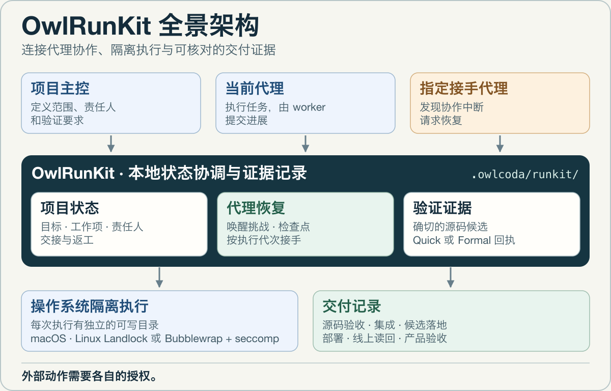
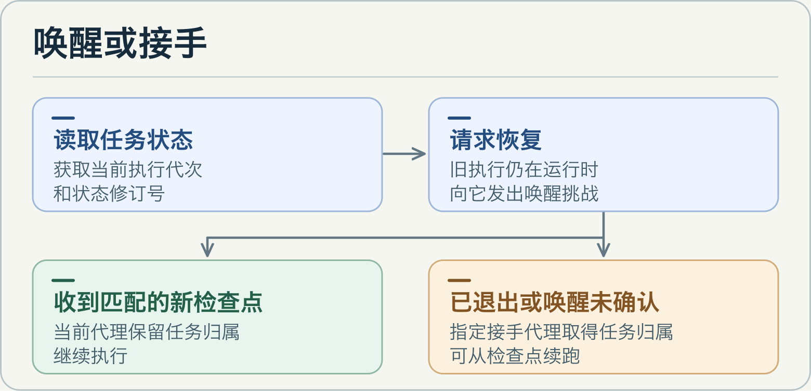

# OwlRunKit

[English](README.md) · **中文** · [使用指南（英文）](docs/guide.md) · [发布记录](https://github.com/yeemio/owlrunkit/releases)

[](https://www.npmjs.com/package/owlrunkit)
[](LICENSE)

**欢迎交流。** 有使用反馈、想法或合作建议，可以在 X 上找到我 [@yeemio](https://x.com/yeemio)。

OwlRunKit 是面向 AI 代理的本地项目协调工具。它把目标、责任人、源码候选、检查点和验证回执保存在项目里，让下一位代理接手时能看清做到哪里、依据是什么、下一步该做什么。

## 全景架构



<details>
<summary>播放架构动画</summary>


</details>

宿主提供触发协作代理的机制。代理决定下一步并提供 worker 命令。RunKit 记录归属，检查状态是否仍符合预期，再把结果和证据绑定起来。操作系统负责强制隔离 worker。Git、发布和部署各自需要独立授权。

## 唤醒还是接手



1. **执行前确定协作关系。** 任务预先指定当前代理、接手代理，以及允许写入检查点的文件。
2. **用新检查点确认进展。** 协作代理发现停滞或退出后，用 `peer inspect` 读取执行代次与状态修订号，再请求恢复。旧 worker 仍在运行时，RunKit 会发出带 ID 的唤醒请求。只有带着同一 ID 返回有变化的检查点，才算确认进展。单独的 ACK 无法确认进展。
3. **从最近的有效检查点接手。** 原执行已退出，或者在限定时间内没有确认唤醒，RunKit 就可以在一条持久化记录中将下一代任务的归属切换给指定代理。过期的接手请求和旧 worker 的迟到上报会被拒绝。接手代理可以在 `peer recover` 里附上 worker 命令，接手后直接续跑。

[接手命令与 worker 消息协议](docs/guide.md#managed-local-peer-recovery)

## 隔离如何保护检查点

每次执行都从最近一次已接受的检查点启动，worker 只能写入自己的独立目录，并向 RunKit 上报已声明的文件。原工作区保持完整，隔离后端阻止网络访问和新子进程。超时的旧 worker 可能仍在自己的目录里运行，RunKit 只接受当前执行的检查点上报。

| 平台 | 受管 worker 的隔离方式 |
| --- | --- |
| macOS | 通过 `sandbox-exec` 使用系统隔离 |
| Linux x86-64 和 ARM64 | 优先使用 Landlock 与 seccomp。Landlock 不可用时，可使用经过验证的系统 Bubblewrap 与 seccomp |

无法建立隔离时，RunKit 会拒绝启动。在系统属主被重新映射的 Linux 环境中，Bubblewrap 后备方案会检查只读 `/usr`，拒绝挂载根与它重叠的可写别名。`0.25.4` 支持同一 OverlayFS 上互不重叠的只读系统目录和可写工作区。

`0.25.4` 正式 npm 包已在这种挂载布局的 Linux x86-64 云电脑上通过受管 worker 强杀测试。接手者从检查点续跑并完成任务，原工作区保持完整。[v0.25.4 发布记录](https://github.com/yeemio/owlrunkit/releases/tag/v0.25.4)

## 交接前审查冻结候选

用 `candidate verify --workspace . --candidate <path> --human` 查看冻结后哪些授权路径发生了变化、Git 基线是否移动，以及哪份 Formal 回执对应冻结候选。接手时，把同一路径传给 `project takeover --workspace . --agent <id> --candidate <path>`，即可同时看到候选、已绑定的 Quick 回执和下一步。

`0.25.5` 已在临时测试仓库完成一次真实模型会话交接验收。两个独立的 Codex 会话核对了同一候选和 Quick 回执，继任者根据交接记录完成了下一项只读任务。

[候选审查和接手命令](docs/guide.md#freeze-a-dirty-worktree-safely)

## 交付证据如何流转

- **项目状态。** Project Driver 记录分工、交接、返工和剩余工作。Team Delivery 提示协调需求、写入范围冲突和验收缺口。
- **候选和回执。** Quick 和 Formal 验证回执绑定确切的源码候选。交接时一并传递责任人、证据和下一步。
- **交付阶段。** 分别记录源码验收、集成、候选落地、部署、线上读回和产品验收。
- **会话连续性。** 会话压缩后，可读紧凑恢复视图核对目标。可选的 Codex Stop hook 能在绑定的 RunKit 文件变化时让仍在等待的会话继续。代理接手机制用于预先配置的受管 worker。

[项目协作](docs/guide.md#project-driver-coordinate-a-multi-agent-project) · [验证模式](docs/guide.md#choose-auto-off-light-managed-or-formal) · [Codex Stop hook 配置](docs/guide.md#optional-codex-file-event-stop-hook)

## 安装与上手

需要 Node.js 20.19 或更新版本。请在项目中锁定精确版本，并使用项目本地 CLI。

```bash
npm install --save-exact owlrunkit@0.25.5
npx --no-install owlrunkit --version
npx --no-install owlrunkit bootstrap --workspace . --exact owlrunkit@0.25.5 --dry-run
npx --no-install owlrunkit bootstrap --workspace . --exact owlrunkit@0.25.5 --apply
npx --no-install owlrunkit doctor --workspace .
```

查看推荐模式和当前项目状态：

```bash
npx --no-install owlrunkit mode recommend --workspace .
npx --no-install owlrunkit inspect --workspace . --json --compact
```

[完整使用指南](docs/guide.md) · [公开合同](docs/architecture/) · [对应源码与 Linux helper 构建](SOURCE.md) · [许可证](LICENSE) · [安全](SECURITY.md) · [贡献](CONTRIBUTING.md)
